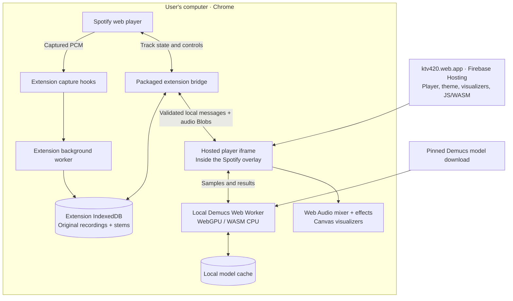

# ktv420 architecture

The website delivers the player code. Chrome runs it locally. Audio is never sent to a ktv420 server.

## Update boundaries

| Change | Delivery |
| --- | --- |
| Homepage, player layout, labels, theme, visualizers, effects, local inference code | Website deployment; reload Spotify to load it |
| Spotify capture hooks, injected launcher, background worker, extension permissions, bridge protocol | Extension update |
| Audio recordings and saved stems | Stay in the same extension's local database |

The hosted player runs inside two nested frames: Spotify → packaged extension bridge → website player. The website frame has no Chrome extension APIs. The bridge checks message origins, windows and protocol versions, and exposes a fixed set of local storage/control operations. A local processing lock prevents concurrent separation jobs from conflicting.

The root URL is the installation guide; `/player/` is the app embedded in Spotify. Opening `/player/` directly shows a Spotify link because it has no extension bridge or audio access there.

An internet connection loads the website and first model download. Once downloaded, computation uses the computer's GPU or CPU. Pending Float32 captures persist in extension IndexedDB; successful processing atomically replaces each original and its four stems with five 320 kbps MP3 files. Protocol v2 validates MPEG-1 CBR frames, finalized gapless metadata, rate, length and common playback gain before committing. The MP3 encoder runs only in a hosted worker; model caches belong to the website. Keeping the same Chrome profile, extension identity and installation folder preserves the audio library. Uninstalling the extension removes that library.

Firebase Hosting remains as static website hosting. There is no Cloud Run processing service and no GCS audio storage. Model files are downloaded from the pinned external model source; captured audio never accompanies those requests. Active players aren't forcibly restarted by deployments, and retained hashed assets keep their code dependencies available.
