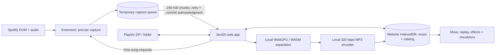

# ktv420 architecture — version 7

The website is the music app. The optional extension integrates Spotify. Audio never goes to a ktv420 server.

On Spotify, a packaged extension frame embeds the hosted capture playlist as a full-window overlay. Its narrow relay derives the Spotify tab from Chrome’s sender information; no tab ID is exposed in a URL. It never mounts the mixer, receives audio chunks, or performs separation. Track clicks and indexed Spotify links open the corresponding top-level ktv420 playlist/track, paused.

The top-level website is the only receiver and owner of audio. Captures remain in the extension’s durable queue until a website transaction commits them. The overlay can schedule the next song immediately after the extension queues the previous one, even if the website is closed. Website pages publish bounded metadata-only captured/processing/ready summaries to the extension; the overlay combines those with queued captures to render progress. It does not require cross-site storage access, an extra permission prompt, or shared iframe storage. Files left in the old overlay partition are ignored, not deleted or migrated; recapture is supported.

`/` and `/catalog` render the catalog; `/playlist` renders the standalone playlist and mixer. `/transfer` and `/replay` work without the extension.

## Ownership and updates

| Website deployment | Extension release |
| --- | --- |
| Library, catalog, import/export, capture order, processing, mixer, effects, visuals and replay | Spotify DOM selectors/discovery, precise capture, temporary delivery storage, website status metadata and versioned operations |

The website’s fresh `ktv420-web-library-v1` IndexedDB database contains tracks, audio Blobs, collections, settings, incoming delivery chunks and commit receipts. Per-song MP3 commits replace raw audio atomically; imported files and metadata commit with collection membership. Processing status remains recoverable from raw input when a worker/tab closes. A website Web Lock excludes competing separation and import/deletion commits. Performance recordings and analysis/model caches remain website-local.

The extension’s new `ktv420-capture-delivery-v1` database contains temporary capture manifests/chunks and a metadata-only website status cache (schema version 3). Previous extension library/state databases are untouched and never opened. Completed queue entries have no automatic expiry. Starting a new capture may clear unfinished staging for that same Spotify tab, but never completed recordings awaiting acknowledgment.

## Protocol and scheduling

`ktv420-spotify`, version 1, is a new protocol. `chrome.runtime.sendMessage` connects a top-level `https://ktv420.web.app` document for delivery operations only. The overlay app uses an origin/source-validated postMessage relay through its packaged parent. The worker accepts Spotify commands only from that extension frame in the enclosing Spotify tab, rejects client-supplied tab IDs, and validates versions, IDs/indexes/volumes and operations:

- `hello`: protocol/extension version.
- `library-summary`: captured/ready metadata plus pending deliveries; no audio.
- `publish-library`: replace status metadata; top-level website only.
- `open-player`: open a website playlist/index matching the bound Spotify route.
- `pending`/`chunk`/`ack`: top-level website only; the capture frame cannot consume or acknowledge audio.
- `discover`, `status`: an identified Spotify tab’s collection and capture state.
- `capture`: one track ID, request UUID and collection path. Retrying the same request reports its status rather than starting another recording.
- `cancel`, `volume`: stop the active primitive or adjust monitoring gain.
- `close`, `view`, `presentation`: close/pause the overlay, synchronize the one-based track URL, or update the Spotify tab title.
- `pending`, `chunk`, `ack`: list completed deliveries, read one bounded chunk, and release a committed delivery.

No arbitrary code, script injection requests, Chrome API relay or website access to old extension storage is exposed. Host access is limited to Spotify and the app origin (the latter permits shared website storage in the hosted overlay). No API permissions are requested.

The website holds a capture-scheduler lock and issues one-song requests sequentially, skipping existing inputs. It does not depend on animation frames or an iframe heartbeat. Spotify’s content script verifies complete discovery, route and song identity before recording. The full hosted playlist, settings and mixer render over Spotify. Close/Escape pauses the mixer, cancels capture scheduling and pauses Spotify; reopening reuses the frame. Direct website playback remains independent of Spotify. Ordinary Spotify playback is untouched until capture is explicitly requested.

If the website closes, no new requests are scheduled. Explicitly closing the Spotify overlay also stops the active capture. The current single capture may finish into the durable queue. Reopening any website page reconnects delivery. The website stores one chunk at a time before requesting the next. Commit receipts prevent duplicate delivery and permit retrying a lost acknowledgment; a later user deletion cannot be undone by an old retry. Transaction failure leaves extension copies available.

## Audio and GPU

The precise capture/worklet pipeline retains its zero-start, sample-clock, source, natural-end and finite-sample checks. Monitor gain is downstream from capture and remains stable through a background website stall; it no longer expires because a hosted iframe missed a heartbeat. Finishing capture releases Spotify audio routing.

The website assembles WAV Blob references without a second full PCM transfer buffer. Demucs and encoding still run in their existing workers. GPU-capable clients explicitly select WebGPU; a GPU initialization failure stays visible and the user can select CPU. Model revision, checksum, Float32 processing, shared MP3 gain and gapless timing are unchanged. Playback has its own clock and no Spotify mirror controller.

Version-2 playlist packages preserve unique audio assets and ordered collection positions, including duplicates. SHA-256, MP3 structural/gapless validation, archive path checks and quotas are checked before committing a song. ZIP export streams, folder/ZIP import works per song, and existing prepared tracks are skipped. No old package support or migration path is included.

## Hosting and verification

Firebase Hosting serves static website/runtime files; model weights come from the pinned data source. No audio upload or backend processing is used. New pages load current code; existing sessions retain their code, with immutable assets retained across deployments.

Automated checks cover delivery interruptions, lost acknowledgments, rollback, duplicates, origin validation, complete ZIP/folder round trips, quota/lock failures and interrupted processing recovery, alongside existing capture/audio/effect/visualizer tests. The standalone development fixture runs the production importer in a real browser. Real Spotify capture and GPU timings must be reported separately from simulated protocol tests.
